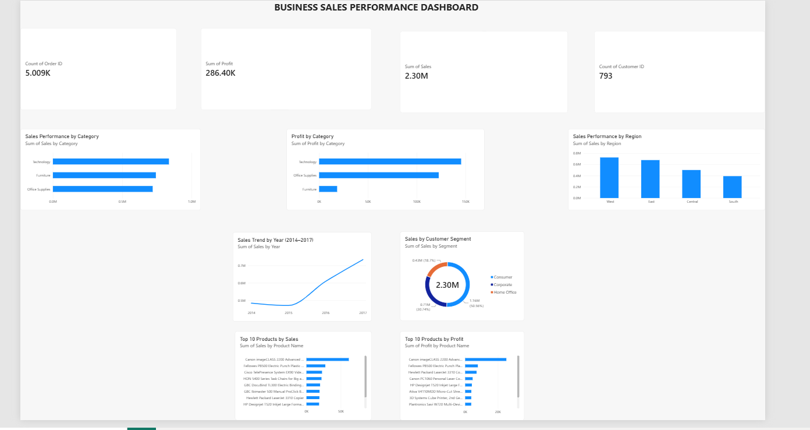

# Business Sales Performance Analytics

**Future Interns — Data Science & Analytics | Task 1**

## Project Overview
This project analyzes retail sales data to understand business performance across products, categories, regions, customer segments, and time.

## Objectives
- Track overall sales, profit, orders, and customers.
- Identify top-performing products and categories.
- Compare regional and customer-segment performance.
- Analyze sales trends over time.
- Build an interactive Power BI dashboard.

## Tools Used
- Microsoft Excel — Data cleaning and analysis
- Microsoft Power BI — Dashboard and visualization

## Dataset
Sample Superstore retail dataset.

## Key Performance Indicators

| KPI | Result |
|---|---:|
| Total Sales | 2.30M |
| Total Profit | 286.40K |
| Orders | 5,009 |
| Customers | 793 |

## Analysis Performed
- Sales and profit by category
- Sales by region
- Yearly sales trends (2014–2017)
- Sales by customer segment
- Top 10 products by sales
- Top 10 products by profit

## Key Insights
- Technology is the highest-performing category by sales.
- The West region records the highest sales.
- The Consumer segment contributes approximately 50.6% of total sales.
- Sales show an overall upward trend from 2014 to 2017.
- Product-level comparisons help identify high-revenue and high-profit products.

## Dashboard Preview

## Repository Contents

| File | Description |
|---|---|
| Business_Sales_Performance_Dashboard.pbix | Power BI dashboard |
| Sales_Performance_Dashboard.png | Dashboard preview |
| Cleaned_Sales_Data.xlsx | Cleaned dataset and Excel analysis |
| Business_Sales_Performance_Report.docx | Project report |

## Recommendations
1. Monitor category and regional performance to identify growth opportunities.
2. Consider product profitability alongside sales when making business decisions.
3. Track customer-segment trends to improve marketing strategies.
4. Monitor sales trends to understand business growth.

## Conclusion
This project demonstrates an end-to-end sales analytics workflow, from data cleaning and analysis to dashboard development and business insights.

**Internship:** Future Interns — Data Science & Analytics  
**Task:** FUTURE_DS_01
